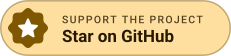

# SHARE64 README snippets

Copy the `assets/` folder into the root of your repository, then paste these blocks into README.md.
Each image has a `-light` and a `-dark` file; the `<picture>` tag picks the right one automatically.

## 1. Badge buttons (put under the title / above the NOTE block)

```html
<p align="center">
  <a href="https://github.com/aravindrejidev/SHARE64/releases/latest">
    <picture>
      <source media="(prefers-color-scheme: dark)" srcset="assets/readme/badges/badge-download-phone-dark.svg">
      
    </picture>
  </a>
  <a href="https://github.com/aravindrejidev/SHARE64/releases/latest">
    <picture>
      <source media="(prefers-color-scheme: dark)" srcset="assets/readme/badges/badge-download-tv-dark.svg">
      
    </picture>
  </a>
</p>

<p align="center">
  <a href="https://github.com/aravindrejidev/SHARE64">
    <picture>
      <source media="(prefers-color-scheme: dark)" srcset="assets/readme/badges/badge-star-dark.svg">
      
    </picture>
  </a>
  <a href="https://github.com/aravindrejidev/SHARE64/issues/new">
    <picture>
      <source media="(prefers-color-scheme: dark)" srcset="assets/readme/badges/badge-bug-dark.svg">
      
    </picture>
  </a>
</p>

<p align="center">
  <a href="https://github.com/aravindrejidev/SHARE64/pulls">
    <picture>
      <source media="(prefers-color-scheme: dark)" srcset="assets/readme/badges/badge-contribute-dark.svg">
      
    </picture>
  </a>
  <a href="https://github.com/aravindrejidev/SHARE64/blob/main/docs/ARCHITECTURE.md">
    <picture>
      <source media="(prefers-color-scheme: dark)" srcset="assets/readme/badges/badge-docs-dark.svg">
      
    </picture>
  </a>
</p>
```

## 2. Section headings (replace the emoji in each `##` title)

```markdown
## <picture><source media="(prefers-color-scheme: dark)" srcset="assets/readme/sections/section-features-dark.svg"></picture> Features
```

Available names: `showcase`, `features`, `how-it-works`, `download`, `troubleshooting`, `security`,
`architecture`, `build`, `support`, `contributing`, `license`.
Just swap `features` in the three places of the line above.

## 3. Feature icons (for the "Why SHARE64" table or a card grid)

```html
<picture>
  <source media="(prefers-color-scheme: dark)" srcset="assets/readme/features/feature-fast-dark.svg">
  
</picture>
<br><b>Fast</b>
```

Available names: `fast`, `private`, `offline`, `resume`, `devices`.
