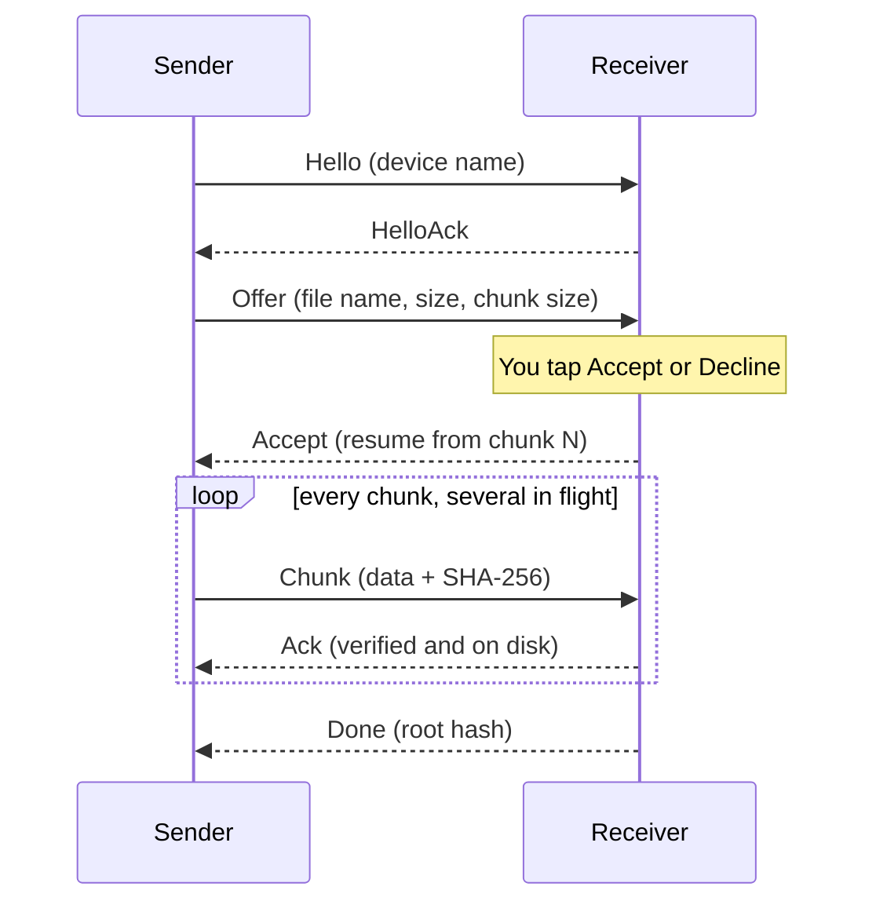

<div align="center">

<br/>


# SHARE64

### Local Wi-Fi file sharing for Android phones and TVs

<p>
  <strong>Send big files to any device on your Wi-Fi. No cloud, no account, no cable.</strong><br/>
  <em>A native C++ transfer engine with SHA-256 verified chunks and automatic resume.</em>
</p>

<br/>

<p align="center">
  <a href="https://github.com/aravindrejidev/SHARE64/releases"></a>
  <a href="https://github.com/aravindrejidev/SHARE64/stargazers"></a>
  <a href="https://github.com/aravindrejidev/SHARE64/releases"></a>
  <a href="https://github.com/aravindrejidev/SHARE64/blob/main/LICENSE"></a>
</p>

<p align="center">
  
  
  
  
  
</p>
<br/>

[**Features**](#features) · [**How it works**](#how-it-works) · [**Download**](#download) · [**Troubleshooting**](#troubleshooting) · [**Security**](#security) · [**Architecture**](#architecture) · [**Build**](#build) · [**Contributing**](#contributing) · [**License**](#license)

<br/>

</div>

> [!NOTE]
> SHARE64 works on your **local network only**. Both devices must be on the same Wi-Fi, Ethernet or hotspot network. Transfers are checked for corruption but are **not encrypted**, so use it on networks you trust. See [Security](#security).

---

<a id="about"></a>
## 🌟 About the Project

**SHARE64** moves files straight from one Android device to another over your own network. Open it on both devices, tap a nearby device, pick your files, and the other side taps **Accept**. The files travel through your router at the speed your Wi-Fi allows, never through a server.

Under the hood, a native C++17 engine streams each file in chunks, verifies every chunk with SHA-256, and picks up where it left off if the connection drops. The same engine powers the **phone app** and the **Android TV / Fire TV app**.

No accounts. No ads. No analytics. Your files never leave your network. The internet is used only to check GitHub for new versions and to show the contributor list on the About screen.

| Why SHARE64 | |
|---|---|
| ⚡ **Fast** | Limited by your Wi-Fi, not by your internet upload speed |
| 🔒 **Private** | No server, no cloud copy, nothing to sign in to |
| 📡 **Works offline** | A router without internet access is enough |
| 🔁 **Resumes by itself** | A dropped connection never means starting over |
| 📺 **Phone to TV and back** | One engine, two apps, same protocol |

<!--
  SHOWCASE (uncomment when the screenshots exist; keep the images in docs/screenshots/)

<a id="showcase"></a>
## 📸 Showcase

<div align="center">
  <table>
    <tr>
      <td width="33%" align="center"><br /><sub><b>Nearby devices</b></sub></td>
      <td width="33%" align="center"><br /><sub><b>Transfer</b></sub></td>
      <td width="33%" align="center"><br /><sub><b>Settings</b></sub></td>
    </tr>
  </table>
  
</div>
-->

---

<a id="features"></a>
## ✨ Features

<div align="center">

<table>
  <tr>
    <td width="50%" valign="top">

#### Transfers
- **Automatic resume** — if Wi-Fi drops, SHARE64 reconnects and continues at the first unverified chunk. Sending the same file to the same device again also picks up where it stopped.
- **Verified chunks** — every chunk carries its own SHA-256, and a root hash confirms the whole file at the end.
- **Large files** — sizes are 64-bit end to end, files are streamed in chunks and never loaded into memory.
- **Several files at once** — pick many files, or share them in from any app with the Android share sheet.
- **You stay in control** — an incoming file asks to be accepted or declined, from a dialog or straight from the notification.
- **No temporary copies** — the file you send is read in place.

#### Devices
- **Automatic discovery** — nearby devices appear on their own (DNS-SD, `_share64._tcp`).
- **Add by address** — type `192.168.1.20` or `192.168.1.20:52364` when discovery is blocked.
- **Network aware** — follows Wi-Fi, Ethernet and hotspot changes and restarts discovery when the network changes.
- **Custom port** — change the receiver port in Settings (1024 to 65535).

    </td>
    <td width="50%" valign="top">

#### Phone app
- **Material 3 design** with dynamic color (Android 12+), light, dark and **AMOLED** themes.
- **Keep receiving in the background** — a small foreground notification keeps you visible to other devices, with a Stop button.
- **Your download folder** — `Downloads/SHARE64` by default, or any folder you choose.
- **Saved to… notifications** — tap to open the finished file.
- **Wi-Fi and wake locks** while transferring, so the screen can turn off.

#### TV app
- **Android TV and Fire TV** with a dark 10-foot interface, D-pad focus rings, Leanback launcher entry and banner.
- **Incoming and outgoing dashboard** on the big screen.
- Receive straight to the TV; send to it from your phone.

#### Updates and About
- **In-app updater** — checks GitHub Releases, picks the APK that matches your device, verifies its SHA-256 and hands it to the Android installer. Android also refuses any APK not signed with the same key.
- **"What's new"** release notes inside the update sheet, and *Skip this version*.
- **About page** with version, CPU architecture and the live contributor list.

    </td>
  </tr>
</table>

</div>

---

<a id="how-it-works"></a>
## 🔬 How a Transfer Works



1. **Find each other.** Both apps announce themselves on the network and listen on port `52364` by default.
2. **Offer.** The sender describes the file. The file is only sent once the receiver accepts, unless *Accept files automatically* is on.
3. **Stream.** The file is cut into 2 MB chunks with four in flight at once. Disk reads and hash checks run on separate worker threads, and on arm64 devices whose CPU supports it, SHA-256 uses the hardware instructions.
4. **Verify.** The receiver checks every chunk before writing it. A damaged chunk is simply sent again.
5. **Resume.** Partial data is kept with a record of what was verified. After a dropped connection the sender reconnects (with back-off) and continues from the first unverified chunk.
6. **Finish.** A root hash over all chunk hashes confirms the whole file, then it moves to your download folder.

The wire format is documented in [docs/ARCHITECTURE.md](docs/ARCHITECTURE.md#wire-protocol-v1).

---

<a id="download"></a>
## 📥 Download & Installation

<div align="center">

<a href="https://github.com/aravindrejidev/SHARE64/releases/latest" target="_blank" rel="noopener noreferrer"></a>

Grab a signed APK from the [Releases](https://github.com/aravindrejidev/SHARE64/releases) page. Sideloading needs "Install unknown apps" enabled for whichever app you download it with.

Once installed, SHARE64 tells you when a new version is out and can download and install it for you.

</div>

### Which file do I pick?

| Your device | Requires | File to download |
|---|---|---|
| Android phone or tablet | Android 10 or newer | `SHARE64-phone-<version>-universal-release.apk` |
| Android TV / Fire TV | Android 7.0 or newer | `SHARE64-tv-<version>-universal-release.apk` |

Not sure? Take the **universal** file; it runs everywhere. If you want a smaller download, pick the file that matches your CPU:

| Suffix | CPU |
|---|---|
| `arm64-v8a` | Almost every phone and TV from the last several years |
| `armeabi-v7a` | Older 32-bit ARM devices |
| `x86_64` | Emulators and Chromebooks |

The in-app updater picks the right file for your device by itself.

### Installing on a TV

The easiest ways to get the APK onto a TV:
- Put the APK on a USB drive and open it with a file manager app on the TV.
- Use `adb`: `adb connect <tv-ip>` then `adb install SHARE64-tv-<version>-universal-release.apk`.

### Check your download (optional)

Every release includes `SHA256SUMS.txt`:

```bash
sha256sum -c SHA256SUMS.txt --ignore-missing
```

> [!TIP]
> Using [Obtainium](https://github.com/ImranR98/Obtainium)? Add this repository and set the APK filter to something like `phone-.*universal` (or `tv-.*universal`), because each release contains APKs for both apps.

### Getting Started
1. Open SHARE64 on **both** devices and connect them to the same network.
2. On the sending device, tap a device under **Nearby devices**, then pick one or more files. You can also share files into SHARE64 from any other app.
3. On the receiving device, tap **Accept** in the dialog or the notification.
4. Find your files in `Downloads/SHARE64`, or in the folder you chose in Settings.

---

<a id="troubleshooting"></a>
## 🛠️ Troubleshooting

<details>
<summary><b>The other device doesn't show up</b></summary>

- Make sure SHARE64 is open (or *Keep receiving in background* is on) on the other device.
- Both devices must be on the **same network**. Guest Wi-Fi and routers with *client isolation* or *AP isolation* block device-to-device traffic.
- Turn off any VPN on both devices for a moment; it can route traffic away from your local network.
- Use **Add by address**. The address of a device is shown in its Settings under *Your address*.
- If you changed the port, a firewall or router rule must allow that TCP port. The default is `52364`.

</details>

<details>
<summary><b>A transfer stopped halfway</b></summary>

It resumes by itself. SHARE64 keeps reconnecting for a few minutes. If it gave up, send the same file to the same device again and it continues from the last verified chunk instead of starting over.

</details>

<details>
<summary><b>Where are my files?</b></summary>

In `Downloads/SHARE64` on Android 10 and newer, or in the folder you picked under **Settings → Download folder**. On Android 9 or older (some TVs) finished files stay in `Android/data/com.share64.app/files/Received`.

</details>

<details>
<summary><b>"App not installed" when updating or installing</b></summary>

Android only lets an app be replaced by an APK signed with the **same key**. If you earlier installed a test build signed with a debug key, uninstall it once and install the release build.

</details>

<details>
<summary><b>The update says I need to allow installs</b></summary>

The first time, Android asks you to allow *Install unknown apps* for SHARE64. The app takes you to that setting and continues the update when you come back.

</details>

---

<a id="security"></a>
## 🔐 Security & Privacy

> [!WARNING]
> Transfers use plain TCP on your local network. SHARE64 checks that files arrive **intact**, but it does **not encrypt** them and it does not verify **who** is sending. Anyone on the same network who can capture traffic could read what you send.

- **Keep *Accept files automatically* off** (the default) unless you fully trust the network. With it on, anyone on your Wi-Fi can send you files without asking.
- **Use networks you trust**, such as your home Wi-Fi or a hotspot you control. Be careful on public or shared Wi-Fi.
- **Nothing is uploaded.** Files go directly between your devices. There are no accounts, no ads and no analytics libraries.
- **The internet is used for two things only:** checking GitHub for a new release, and loading the contributor list on the About screen.
- **Safe updates.** An update is checked against the release's SHA-256 list, and Android refuses it unless it is signed with the same key as the installed app.

Found a security problem? Please contact the developer through their [GitHub profile](https://github.com/aravindrejidev) instead of posting the details publicly.

---

<a id="architecture"></a>
## 🏗️ Architecture & Tech Stack

SHARE64 is a multi-module Gradle project. The performance-critical part is plain C++17; everything around it is Kotlin.

| Module | What it does |
|---|---|
| `core-cpp` | C++17 engine and JNI bridge: wire protocol, chunking, SHA-256 (with ARMv8 hardware path), resume, retries |
| `core-network` | Device discovery with `NsdManager`, network change watching, handshake probe, peer registry |
| `core-app` | Foreground service, notifications, settings, file export, in-app updater, release-notes renderer |
| `app-mobile` | Phone app (Jetpack Compose, Material 3) |
| `app-tv` | Android TV / Fire TV app (Compose, D-pad focus) |

**Built with:** Kotlin 2.2 · Jetpack Compose · Material 3 · Kotlin Coroutines & Flow · C++17 (NDK r27, CMake) · Android Gradle Plugin 8.12 · GitHub Actions

**Quality checks**
- A C++ **loopback and fault-injection suite** kills connections, flips bits on the wire, restarts the sender mid-transfer and tests accept, decline and cancel. CI also runs it under **AddressSanitizer and UBSan**.
- JVM unit tests for discovery, address parsing, the updater, formatting and more.
- Native libraries are built with **16 KB page alignment** for Android 15+.

Full details, including the wire protocol: **[docs/ARCHITECTURE.md](docs/ARCHITECTURE.md)**

---

<a id="build"></a>
## 🧰 Building from Source

```bash
git clone https://github.com/aravindrejidev/SHARE64.git
cd SHARE64

# Phone app, one CPU architecture (fast)
./gradlew :app-mobile:assembleDebug -Pshare64.abis=arm64-v8a -Pshare64.universal=false

# TV app
./gradlew :app-tv:assembleDebug -Pshare64.abis=arm64-v8a -Pshare64.universal=false
# APKs end up in app-mobile/build/outputs/apk/debug/ and app-tv/build/outputs/apk/debug/
```

*Prerequisites:* JDK 17, Android SDK 36, NDK `27.3.13750724` and CMake `3.22.1` (install the last two from Android Studio's SDK Manager).

**Run the tests**
```bash
# Kotlin unit tests
./gradlew :core-network:testDebugUnitTest :core-app:testDebugUnitTest

# C++ engine tests (any Linux machine with CMake and a C++17 compiler)
cmake -S core-cpp/src/main/cpp -B build && cmake --build build -j && ./build/share64_host_test
```

<details>
<summary><b>For maintainers: publishing a release</b></summary>

1. Edit **`Relece_notice.md`** in the repository root. Its text is what people see under "What's new" in the update sheet. (`Release_notice.md` works too.)
2. Go to **Actions → Release → Run workflow** and fill in `version_name` (e.g. `1.0.0`), `version_code`, `target_device` (`all`, `phone` or `tv`), `build_type` and `publish_release`.
3. The workflow runs the tests, builds every CPU variant plus a universal APK per app, verifies each signature and publishes a GitHub Release with `SHA256SUMS.txt`.

Keep in mind:
- Always sign with the **same keystore**. Set the secrets `SHARE64_KEYSTORE_BASE64`, `SHARE64_KEYSTORE_PASSWORD`, `SHARE64_KEY_ALIAS` and `SHARE64_KEY_PASSWORD`. Without them the APKs are signed with the debug key, which is only fine for testing.
- The repository must stay **public** so the in-app updater can read releases and notes.
- Version names look like `1.2.3` (or `1.2.3-beta.1`). Release builds are offered to users by the updater; debug builds and prereleases never are.

</details>

---

<a id="support"></a>
## ☕ Support the Project

SHARE64 is free and open source, with no ads or subscriptions. If it saved you a cable or a cloud upload, you can help by:

- ⭐ **Starring** the repository
- 📣 **Sharing** it with friends who move big files around
- 🐛 **Reporting** bugs and odd behavior on the [issues page](https://github.com/aravindrejidev/SHARE64/issues)

<!-- Add your donation links here, for example Ko-fi or PayPal -->

### 📈 Star History

<p align="center">
  <a href="https://star-history.com/#aravindrejidev/SHARE64&Date">
    
  </a>
</p>

---

<a id="contributing"></a>
## 💡 Contributing

Contributions are welcome, whether it's a bug fix, a new idea or clearer wording.

- Found a problem? Open an [issue](https://github.com/aravindrejidev/SHARE64/issues) and tell us the device model, Android version, app version and what you expected. For network problems, mention the router or hotspot type.
- For bigger changes, open an issue first so we can talk it through.
- Pull requests should build cleanly, keep the Kotlin unit tests and the C++ engine tests (`share64_host_test`) green, and stay focused on one thing.
- By contributing you agree that your work is released under the project's GPL-3.0 license.

### 👥 Contributors

<div align="center">
  <a href="https://github.com/aravindrejidev/SHARE64/graphs/contributors">
    
  </a>
  <br/>
  <sub>The same list appears inside the app on the About screen.</sub>
</div>

---

<a id="acknowledgments"></a>
## 🤝 Acknowledgments

- **Jetpack Compose** and **Material 3** for the interface.
- **Kotlin Coroutines** for the glue between the native engine and the UI.
- **Android `NsdManager`** for zero-configuration discovery.
- **[Shields.io](https://shields.io/)**, **[Star History](https://star-history.com/)** and **[contrib.rocks](https://contrib.rocks/)** for the badges and charts on this page.

---

<a id="license"></a>
## ⚖️ License & Disclaimer

### License
SHARE64 is released under the **GNU General Public License v3.0**. See the [LICENSE](LICENSE) file for details.

### Disclaimer
- **Integrity, not secrecy.** Files are verified for corruption, but traffic is not encrypted. See [Security](#security).
- **Only share what you may share.** You are responsible for the files you send and receive.
- **No warranty.** The software is provided "as is", as described in the license.
- Android, Android TV and Fire TV are trademarks of their respective owners. SHARE64 is an independent project and is not affiliated with them.

---

<div align="center">
  Made by <a href="https://github.com/aravindrejidev">Aravind</a> with C++, Kotlin and a lot of test transfers. Happy sharing! 📲
</div>
