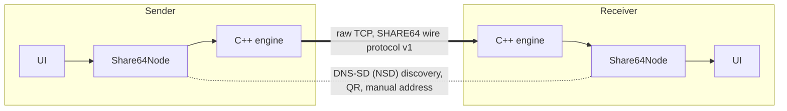
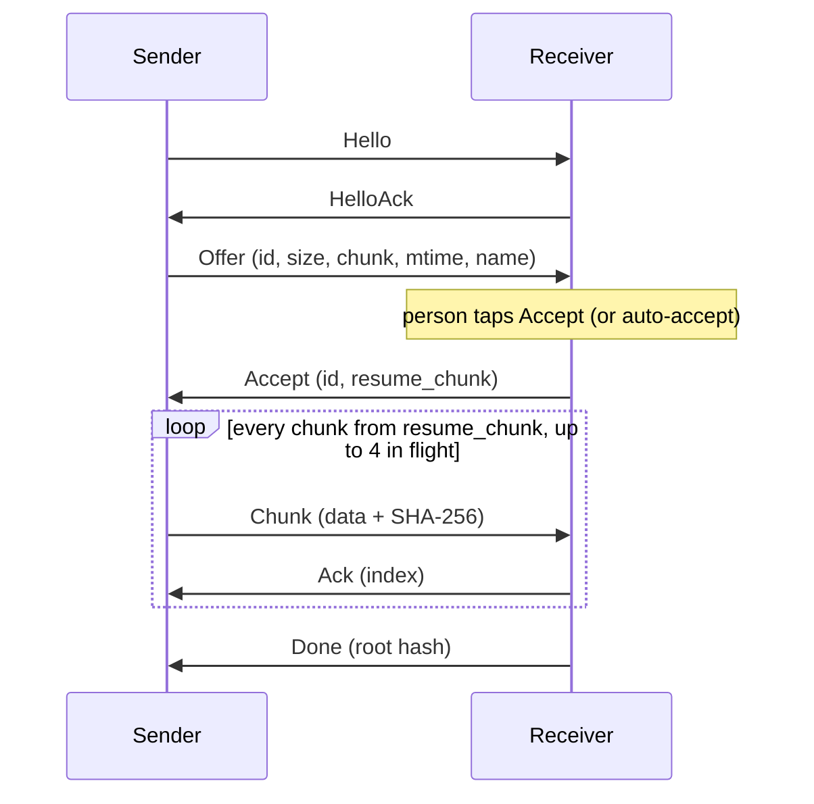

# SHARE64 architecture

This page explains how SHARE64 is put together: the modules, how devices find each other, the wire
protocol the two apps speak, the "Share with anyone" web mode, and the file picker the TV app brings
along. It is written for people who want to read, build or extend the code.

- [Big picture](#big-picture)
- [Modules](#modules)
- [Discovery and connecting](#discovery-and-connecting)
- [Wire protocol v1](#wire-protocol-v1)
- [Network awareness](#network-awareness)
- [Share with anyone (web mode)](#share-with-anyone-web-mode)
- [The TV file picker](#the-tv-file-picker)
- [Updates and release notes](#updates-and-release-notes)
- [Tests and CI](#tests-and-ci)
- [Security notes](#security-notes)

## Big picture

Two devices on the same network. One **sends**, one **receives**. Nothing goes through a server.



Every device runs both roles: it listens on a TCP port (default `52364`) so others can send to it, and
it can open a connection to send. Discovery only tells a device *where* the others are.

## Modules

```
app-mobile ─┐
            ├─► core-app ─► core-network ─► core-cpp (C++ engine + JNI)
app-tv ─────┘
```

| Module | What lives there |
|---|---|
| `core-cpp` | The C++17 transfer engine (`src/main/cpp`) and its Kotlin wrapper (`TransferEngine`, `TransferEvent`). Sockets, framing, chunking, SHA-256 (ARMv8 crypto instructions on `arm64-v8a`), resume store, worker threads. Builds as a shared library for Android and as a plain static library for host tests. |
| `core-network` | Everything about *finding and reaching* other devices, in Kotlin: `Share64Node` (owns the engine, the peer list and the transfer list), `DiscoveryManager` (DNS-SD), `SubnetScanner`, `HandshakeProbe`, `NetworkWatcher`, `NetworkProfile`, `QrPayload`/`QrCode`, and the `web/` package (HTTP server for "Share with anyone"). |
| `core-app` | Code shared by both apps that needs Android: `ShareService` (foreground service), `ShareRuntime`, `AppSettings`, notifications, the in-app updater, `WebShareHost`, `WebDownloader`, received-file export, and the TV picker's helpers (`FileBrowser`, `StorageAccess`). |
| `app-mobile` | Phone UI: Jetpack Compose, Material 3 Expressive, touch. |
| `app-tv` | TV UI: Compose, D-pad focus, 10-foot layout, built-in file picker. |

The two apps share one application id (`com.share64.app`); a device installs the phone or the TV
build, never both.

### Phone screens

The phone app has two tabs behind a floating bar: **Send** (the files you picked, then the nearby
devices) and **Receive** (this device's name with the sharing switch, the **Scan QR code** button and
the devices waiting for an answer). The Settings button stays at the top of both. The QR code opens as a
bottom sheet from Send with a switch for its two uses: *Via SHARE64* (this device's pairing code) and
*Share with anyone* (the web-mode link). Scanning happens on its own screen, reached from Receive; it
understands both kinds of codes.

### Process model

`ShareService` is a foreground service that owns the one `Share64Node`. The UIs never create a node;
they observe `ShareRuntime.node` (a `StateFlow`) and render its flows (`peers`, `transfers`,
`discoveryStatus`, `localAddresses`, `listeningPort`). That is why the UI can disappear and transfers
keep running, and why a UI keeps working while the node restarts after a setting changes.

The engine reports progress from its own throttled reporter thread; the JNI bridge turns those events
into Kotlin flows, so the streaming loop never waits for the UI.

## Discovery and connecting

There are three ways to learn about another device. All of them end in the same place: an address and
a port to connect to, plus a stable **device id** so resume still works when the address changes.

### 1. DNS-SD (automatic)

Each device registers an NSD service of type `_share64._tcp` and browses for the same type. The TXT
record carries four keys:

| Key | Meaning |
|---|---|
| `id` | Stable device id, 8 to 64 characters (letters, digits, `-`) |
| `n` | Display name, sanitised, at most 48 characters / 96 bytes of UTF-8 |
| `t` | Device type: `p` phone, `t` TV, `o` other |
| `v` | Protocol version (currently `1`) |

Records that are not well-formed are ignored.

### 2. Subnet sweep and liveness probes

DNS-SD is often blocked or flaky on phone hotspots and USB tethering, so on those networks
(`NetworkKind.isHotspotLike`) SHARE64 also sweeps the subnet and probes known peers regularly. A probe
is a real protocol handshake (`HandshakeProbe`): Hello, then HelloAck. Anything that does not answer
with a valid HelloAck is not treated as a SHARE64 device.

### 3. QR code or typed address

A device can show a QR code (Send, then Use QR code); another device scans it (Receive, then Scan QR code). The text inside is:

```
share64://c?v=1&i=<device id>&n=<name>&t=<p|t|o>&p=<port>&a=<ip>,<ip>
```

- At most 4 addresses, **private IPv4 only** (10/8, 172.16/12, 192.168/16). The scanner tries all of
  them and keeps the one that answers, so a code can never point the app at a host on the internet.
- Unknown fields are ignored, so later versions can add to it. A code with a higher `v` than the app
  understands is reported as "newer version".
- The TV has no camera, so it only *shows* its code.

A typed address (`ip` or `ip:port`) is checked with the same handshake before it is added.

## Wire protocol v1

Raw TCP, **little-endian**. The sender connects to the receiver's listening port.

### Frame header (16 bytes)

| Offset | Size | Field | Notes |
|---|---|---|---|
| 0 | 4 | `magic` | `0x34365348` (bytes `48 53 36 34` on the wire) |
| 4 | 1 | `version` | `1` |
| 5 | 1 | `type` | see below |
| 6 | 2 | `flags` | reserved, `0` |
| 8 | 4 | `length` | payload bytes that follow |
| 12 | 4 | `aux` | chunk index for `Chunk` and `Ack`, otherwise `0` |

Control frames (everything except `Chunk`) are limited to 2048 bytes. A `str` is a `u16` byte length
followed by UTF-8 bytes.

### Message types

| Type | Name | Direction | Payload |
|---|---|---|---|
| 1 | `Hello` | sender to receiver | `caps u32`, `device str` |
| 2 | `HelloAck` | receiver to sender | `caps u32`, `device str` |
| 3 | `Offer` | sender to receiver | `id u64`, `size u64`, `chunk u32`, `mtime_ms i64`, `name str` |
| 4 | `Accept` | receiver to sender | `id u64`, `resume_chunk u64` |
| 5 | `Reject` | receiver to sender | `code u32`, `message str` |
| 6 | `Chunk` | sender to receiver | `aux` = chunk index; payload = data bytes followed by `SHA-256(data)` |
| 7 | `Ack` | receiver to sender | `aux` = chunk index (verified and on disk, in order) |
| 8 | `Done` | receiver to sender | 32-byte root hash |
| 9 | `Error` | either | `code u32`, `message str` |

### One transfer



- **Chunks.** The sender decides the chunk size (default 2 MB, maximum 16 MB); the receiver follows
  the offer. At most `2^22` chunks per file. Up to 4 chunks are in flight at once (the window).
- **Verification.** Every chunk travels with its own SHA-256. The receiver checks it before writing
  and acknowledging. The root hash in `Done` is the SHA-256 over all chunk hashes, so both sides can
  confirm the whole file without a second pass over the data.
- **Transfer id.** Deterministic: the first 8 bytes of `SHA-256(name 0x00 size 0x00 mtime_ms 0x00 peer)`,
  read as a little-endian `u64` (never 0). Sending the same file to the same device again therefore
  resumes, even after an app restart.
- **Resume.** The receiver keeps `.share64/<id>.part` and `.share64/<id>.meta` next to the target
  folder. The `.meta` file is a 64-byte header (magic, version, id, size, chunk size, committed chunks)
  followed by one 32-byte hash per chunk. `Accept.resume_chunk` is the number of chunks already
  committed; the sender continues from exactly there. If a `Done` frame is lost, a re-offer inside a
  10-minute window is answered from the metadata.
- **Dropped connections.** TCP keep-alive is tuned tight (idle 3 s, probe every 1 s, 3 probes), so a
  vanished Wi-Fi link is noticed in a few seconds (these are the engine's defaults). The sender then retries and waits for the network
  to come back (up to 30 minutes by default) and resumes.
- **Rejecting.** `Reject` carries a numeric code and a short message, for example when the person taps
  Decline.

### Versioning

`version` in the header and `v` in the TXT record are both `1`. A peer that sends another version is
refused at the first frame. The `caps` fields (Hello and HelloAck) are there for optional features, so
they can be added without changing the layout of existing messages.

## Network awareness

`NetworkProfile` classifies each private IPv4 address of the device: Wi-Fi, Ethernet, a phone hotspot
it has joined, its own hotspot, USB tethering, or "other local network". Known hotspot gateway
addresses (`192.168.43.1`, `172.20.10.1`, `192.168.49.1`, `192.168.137.1`) are recognised.
`NetworkWatcher` reports the current network and every change to `DiscoveryManager`, which uses it to
keep the registered service and the peer list in step with the network. On hotspot-like networks
discovery adds the subnet sweep described above.

## Share with anyone (web mode)

For people who do not have SHARE64. The host picks files and shows a QR code; any phone camera opens
a page in the browser, and a SHARE64 user who scans it in the app downloads through the app instead.
Only the sending side exists (no upload from the browser).

The host runs a small HTTP server (`WebShareServer`, plain sockets, no third-party library) for the
lifetime of the session. The address is:

```
http://<private ip>:<port>/s/<token>/
```

`token` is 12 random alphanumeric characters. The default port is `8080`; if it is taken the next
free ones are tried. SHARE64 apps also accept `share64://w?u=<url-encoded address>`, which the web page's
"Open in SHARE64" button uses.

| Request | What it does |
|---|---|
| `GET /s/<token>/` | The download page (one self-contained HTML document). |
| `POST /s/<token>/access` | A device asks to get in. Form field `label` names it. Answers JSON with `state` (`pending`, `approved`, `denied`, `full`, `none`) and sets a cookie that identifies the device. |
| `GET /s/<token>/manifest.json` | The file list (`id`, `name`, `size`, `mime`). Approved devices only. |
| `GET /s/<token>/f/<id>` | One file. Supports `Range` and `HEAD`, so downloads resume. Approved devices only. |
| `GET /s/<token>/zip` | All files as one streamed ZIP (compression switched off, since media is already compressed). Approved devices only. |

Access rules:

- The host **approves each new device** (Allow / Decline), unless "Let new devices in automatically"
  is on. Approval is tied to the cookie.
- Only loopback and private-network addresses are served at all.
- Limits: 8 devices per session, 3 per IP address, 32 simultaneous connections. A device that keeps
  guessing tokens is throttled (HTTP 429).
- The session ends after 30 minutes without a request or running download, or when the host taps Stop.
- The page is **not encrypted** (plain HTTP on the LAN). The token and the approval step are what keep
  strangers out, so approve only people you know.

Both the phone and the TV can host a session: the UI starts it through `WebShareHost`, which keeps it
alive through the foreground service. In the app, `WebDownloader` is the receiving side for scanned
links; it downloads with resume and saves through the same exporter as normal transfers.

## The TV file picker

Many TVs and Fire TV boxes ship without a system file picker, so `ACTION_OPEN_DOCUMENT` has nothing to
answer it. The TV app therefore browses storage itself.

- **`FileBrowser`** (`core-app`, pure JVM, unit-tested): lists a folder (folders first, then files, A to
  Z ignoring case, dot-files hidden), works out the parent folder without ever climbing out of a
  storage, and builds breadcrumb labels.
- **`StorageAccess`** (`core-app`): the permission check, the way to ask for it, and the list of
  places to start from (internal storage, USB drives and SD cards, plus shortcuts such as Downloads).
- **`TvFilePicker`** (`app-tv`): the D-pad UI. OK opens a folder or ticks a file, Back goes up one
  folder, Right moves to the panel with the Send / Share button.

Permissions by Android version:

| Android | What the TV app needs |
|---|---|
| 11 and newer | "All files access" (`MANAGE_EXTERNAL_STORAGE`), switched on in Settings |
| 7 to 10 | `READ_EXTERNAL_STORAGE`, asked at runtime (plus `requestLegacyExternalStorage` on 10) |

When access cannot be granted, the TV offers the system picker if the TV has one. The picker only ever
reads the files that were ticked; they are sent through the same engine (or web share) as files from the
phone, using `file://` URIs that stay inside the app.

## Updates and release notes

`UpdateManager` (in `core-app`) asks the GitHub Releases API for the latest release, picks the APK that
matches the device's CPU, checks its size and SHA-256 against `SHA256SUMS.txt`, and hands it to the
system installer. Android itself refuses an APK that is not signed with the same key.

The "What's new" text comes from **`Release_notice.md`** in the repository root, read at the release tag
first and then from `main`. The old misspelt name `Relece_notice.md` is still read as a fallback.

## Tests and CI

| What | Where | How to run |
|---|---|---|
| C++ engine: loopback transfers, fault injection, resume | `core-cpp/src/main/cpp` | `cmake -S core-cpp/src/main/cpp -B build && cmake --build build -j && ./build/share64_host_test` |
| Same under AddressSanitizer + UBSan | `.github/workflows/engine-tests.yml` | runs on every push |
| JVM unit tests: protocol helpers, QR, web share server, updater, file browser | `core-network/src/test`, `core-app/src/test` | `./gradlew :core-network:testDebugUnitTest :core-app:testDebugUnitTest` |
| Release build (all ABIs, signing check, GitHub Release) | `.github/workflows/release.yml` | Actions, Release, Run workflow |

The release workflow runs the engine tests and the JVM unit tests before it builds anything.

## Security notes

- Everything stays on the local network. The internet is used only to check GitHub for updates and to
  show the contributor list on the About screen.
- The native protocol is not encrypted. Integrity is checked per chunk and for the whole file with
  SHA-256, but it is not authentication; use networks you trust.
- QR codes and manual addresses accept private IPv4 addresses only.
- Received file names are sanitised, and a file never overwrites an existing one (a number is added).
- "Accept files automatically" is off by default; turning it on lets anyone on the network send files.
